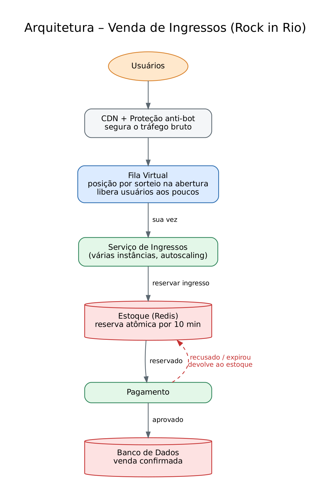

# Arquitetura – Sistema de Venda de Ingressos (Rock in Rio)

## Problemas a resolver
1. **Pico de acessos** muito maior que a quantidade de ingressos.
2. **Nunca vender mais ingressos do que existem** (overselling).
3. **Justiça**: quem tem internet mais lenta não pode ser prejudicado.

## Como a arquitetura resolve

### 1. Borda (CDN + WAF)
Páginas estáticas servidas pela CDN, sem tocar nos servidores. O WAF bloqueia bots, aplica CAPTCHA e rate limit por IP/conta.

### 2. Fila virtual (Waiting Room)
- **Antes da abertura**, todos que chegam entram numa pré-fila e recebem uma **posição sorteada** no momento da abertura. Quem entrou 5 minutos antes ou 1 segundo antes tem a mesma chance — a velocidade da conexão deixa de importar.
- **Depois da abertura**, a ordem é FIFO usando o **timestamp do servidor**, não do cliente.
- O **Admission Controller** libera apenas N usuários por minuto (capacidade do backend + estoque restante) e entrega um **token assinado (JWT)**. Sem token, não se chega ao núcleo de compra.
- Quando o estoque zera, a fila é encerrada e todos são avisados imediatamente.

### 3. Núcleo de compra
- **Ticket Service** stateless, com autoscaling. Como a fila controla a vazão, ele nunca recebe mais tráfego do que suporta.
- **Reserva atômica** no Redis via script Lua (`se estoque > 0 → DECR`). Operação atômica = impossível dois usuários pegarem o último ingresso.
- A reserva tem **TTL de 10 minutos**: o usuário tem tempo para pagar, mesmo com internet lenta, e o ingresso fica garantido para ele.

### 4. Processamento assíncrono
- Pedidos reservados vão para uma fila de mensagens (Kafka/SQS), absorvendo picos e permitindo retry.
- **Payment Service** com chave de idempotência (evita cobrança duplicada).
- **Expiration Worker**: se o pagamento falhar ou o TTL expirar, devolve o ingresso ao estoque e a fila libera o próximo usuário.
- **Order Service** grava a venda no **PostgreSQL** (fonte da verdade) com `UNIQUE(ingresso_id)` — última barreira contra overselling.
- **Notification Service** envia o ingresso (QR Code).

## Garantias
| Requisito | Mecanismo |
|---|---|
| Aguentar qualquer demanda | CDN + fila virtual controlando vazão + serviços stateless com autoscaling |
| Sem overselling | Decremento atômico no Redis + constraint UNIQUE no banco |
| Justiça (internet lenta) | Sorteio na pré-fila, timestamp do servidor e reserva com TTL generoso |
| Resiliência | Mensageria, idempotência, retries e devolução automática de estoque |
